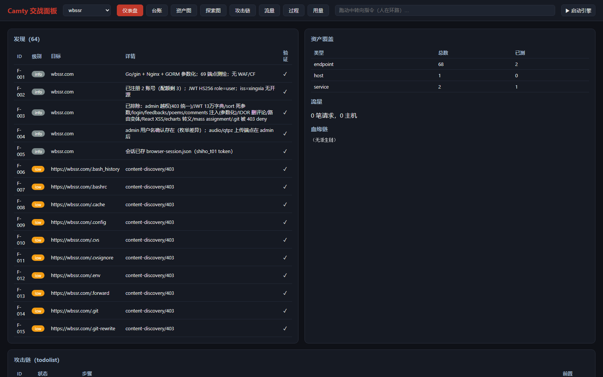

# [开源] Camty：红队交战工作台——41 适配器 + 多 Agent 引擎 + 证据链自动归档

## TL;DR

把渗透测试变成一条可审计的流水线。侦察→验证→利用→横向→报告全链自动化，证据台账带血缘，LLM 规划者自主决策，范围外目标引擎直接拒绝。

**GitHub**: https://github.com/MiyanoShihoo/camty

## 它解决什么问题

打完一次渗透，你面对的是：
- 5 个终端 tab 的工具输出
- 30 张截图但不知道哪张对应哪个测试
- 发现了个洞但忘了上下文参数

**信息有了，证据链没建立。**

Camty 的核心设计：每个动作先过 scope 白名单 → 落审计哈希链（防篡改）→ 进带血缘的证据台账。利用级动作必须引用台账中已验证发现的 ID——**不是弹窗让你确认，是引擎直接拒绝执行**。

## 架构速览

```
┌─────────────────────────────────────────────────┐
│  证据链治理层                                    │
│  scope 白名单 → 审计哈希链 → 血缘台账 → finding 门控 │
├─────────────────────────────────────────────────┤
│  认知层                                          │
│  资产图（真值库+覆盖度）  探索图（意图+血缘）         │
│  多 Agent 引擎（LLM 规划者 → N worker 并行执行）    │
├─────────────────────────────────────────────────┤
│  弹药层（41 适配器）                               │
│  测绘: osint→subfinder→httpx→js-recon→cve-intel   │
│  注入: inj-probe（GET/POST/JSON × 7 变体 evasion） │
│  越权: authz-probe（A/B 双账号鉴权矩阵）            │
│  AD: impacket 13 件 + 5 引擎横向 + kerberoast     │
│  C2: 会话管理 + 任务下发 + 凭据回收                 │
├─────────────────────────────────────────────────┤
│  对抗层                                          │
│  Chrome TLS 指纹伪装 / stealth 三态 / MITM 留痕    │
└─────────────────────────────────────────────────┘
```

## 三个设计决策值得展开说

### 1. 证据链优先，不是功能优先

大多数框架先堆功能再想"怎么证明"。Camty 反过来：**先把证据链治理做硬，功能是往链上挂的工具。**

血缘台账长这样：

```
F-001 [vuln][high] kerberoastable-spn — 验证发现
F-005 [access][high] captured-ntlm-hash ← F-001 — 利用发现（引用 F-001）
```

`← F-001` 不是装饰。secretsdump、lateral-move 这类利用级动作必须带 `finding_id` 参数且引用台账中 `verified` 状态的发现，否则引擎拒绝。这意味着你不可能"跳过验证直接打"。

### 2. LLM 引擎的三层兜底

LLM 驱动自动化的最大坑：**模型不可控**。限流、幻觉、输出格式漂移。Camty 的对策：

- **限流退避**：规划请求失败后按次数 sleep 重试（实战校准：某 API 免费 60 秒窗口）
- **降级确定性**：连续 3 次失败自动切换到 pack 确定性模式继续执行——LLM 挂了不卡交战
- **人在环路**：面板输入框随时注入"换个方向"，worker 下一轮消费；消费即标记，断点续跑不重复注入

### 3. 对抗层是内建的不是外挂

- 全流量 curl_cffi Chrome TLS 指纹（某 API 网站的 CF 对 urllib 直接 403 error 1010，Chrome 指纹秒过）
- 浏览器 stealth 三态——**实战发现 stealth 注入与 Turnstile 互斥**（chrome runtime 伪装破坏 CF 脚本环境），auto 模式默认关注入，visit 自动探测验证码组件输出建议
- 注入七变体混淆（大小写/内联注释/注释分拆/URL 编码/双重编码/HPP/chunked 传输）

## 面板截图



七页签：力导向资产覆盖图 / 流量逐条回放 / 攻击链 / 探索图 / 审批队列 / 人在环路转向

## 快速上手

```bash
git clone https://github.com/MiyanoShihoo/camty.git && cd camty
pip install -r requirements.txt
python -m pytest tests/ -q    # 245 项自检全绿

# 写一个授权配置 yaml，然后：
python -m camty auto target.yaml                        # 确定性全链
python -m camty engine target.yaml --agent --budget 30  # LLM 引擎
python -m camty report target.yaml --format html         # 出报告
```

## 两个真实目标的验证

1. **Go+GORM 工业级防线站**：25+ 攻击线全排——注入全参数化、越权全有权限门、JWT 13 万字典没中。最终能输出"测过了、确实没洞"的证据支撑结论
2. **个人诗歌站**：三阶段（人工 15 线 + AI 引擎 25 步 + 旁路端口扫描）——AI 引擎发现了我漏掉的旁路测绘方向

## 技术栈

Python 3.12+，核心依赖仅 PyYAML + FastAPI（面板）+ curl_cffi（指纹）。245 项测试含真实 HTTPS MITM E2E。C2 植入体纯 C（零依赖 AES/SHA/HMAC），服务端单文件 Python。

Apache 2.0，仅供授权测试使用（scope 引擎强制拒绝，不靠自觉）。

欢迎 star / issue / PR / 讨论。有具体的攻击场景想自动化的，提 issue 我来写适配器。

---

> 仅供已获明确书面授权的安全测试与研究使用。使用者自行承担全部法律责任。
