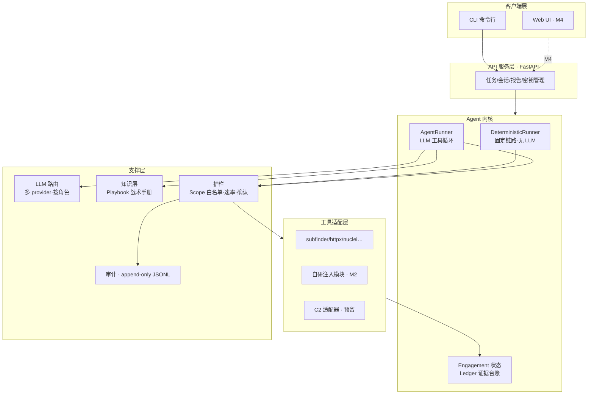

# Camty — 安全交战工作台 架构设计

> 内部代号 Camty（战情室），可改。内部团队交战使用，不上架、不对外。

## 1. 定位

面向红队/渗透测试团队的 **人机协同** 交战自动化工作台：

- **两条场景链全覆盖**：外部 Web 打点（ext-web 包）、内网域渗透（int-ad 包）
- **导入 API key 即用**：多 LLM provider 接入，LLM 负责判断与编排，工具负责执行
- **本地优先**：密钥本地保存，敏感交战可切换本地模型（Ollama/vLLM）全离线运行
- **证据优先（evidence-first）**：一切结论落到可回放的证据上，LLM 只消费结构化摘要，不碰原始输出

明确不做的：全自动无人值守打点（默认危险动作需 operator 确认）、SaaS 多租户、对外服务。

## 2. 总体架构



分层职责：

| 层 | 职责 | 不负责 |
|---|---|---|
| 客户端 | 发起交战、看进度、确认危险动作 | 业务逻辑 |
| Agent 内核 | 计划、工具循环、状态推进、断点 | 直接执行命令（必须经适配器） |
| 支撑层 | 模型路由、知识注入、范围校验、留痕 | 决策 |
| 工具适配层 | 外部工具/自研模块统一封装、结构化输出 | 范围判断（信任护栏层） |

## 3. 技术选型

- **Python 3.11+**（开发机为 3.14），团队上手成本最低，安全工具生态原生
- **核心引擎零框架**：不用 LangChain/LlamaIndex。工具循环自持，每一步可调试、可回放——重框架在长任务里的行为不透明，出问题时无法归因
- **核心依赖仅 pyyaml**；API 层 fastapi/uvicorn 为可选依赖
- **LLM 协议**：三协议全覆盖——Chat Completions（官方 OpenAI 与全部第三方兼容端：DeepSeek/Qwen/Moonshot/vLLM/Ollama/OpenRouter）、OpenAI **Responses 原生协议**、Anthropic 原生协议，统一归一化为内部消息格式
- **存储**：SQLite（状态与断点，M3 切换，骨架先用 JSON 原子写）/ JSONL（审计）/ YAML（pack、scope、engagement）

## 4. Agent 内核

### 4.1 交战任务模型

```
Engagement（一次交战）
 └─ Phase（阶段，来自场景包定义）
     └─ Step（工具调用 + 参数 + 是否需确认）
```

Phase 之间是**门控**关系：上一阶段产出未达标（如 recon 无存活资产）则不进入利用类阶段，由引擎强制，不依赖 LLM 自觉。

### 4.2 证据优先（反幻觉的脊柱）

- 适配器输出**必须**解析为结构化 `ToolResult{summary, data, evidence}`，原始输出落证据文件
- LLM 上下文里只注入：Ledger 摘要（每条 finding 一行）+ 命中的 playbook 片段
- **利用级动作前置校验**：LLM 想执行利用类步骤时，必须引用 Ledger 中已验证 finding 的 ID，否则引擎拒绝执行。宁可少打，不可幻觉

### 4.3 上下文管理

- 上下文 = 系统提示（角色 + evidence-first 规则）+ 当前 phase 目标 + Ledger 摘要 + 最近 N 步工具结果
- 工具原始输出（可能几 MB）**永不**直接进上下文，只进 `summary` 和证据文件
- 滚动窗口保留最近 20 轮，更早的靠 Ledger 承载结论

### 4.4 双 Runner

| | DeterministicRunner | AgentRunner |
|---|---|---|
| 驱动 | pack 里写死的步骤链 | LLM 工具循环 |
| 需要 API key | 否 | 是 |
| 适用 | 冒烟、无人值守侦察、固定动作 | 探索性判断、动态决策 |
| 跑偏风险 | 无 | 用 phase 门控 + playbook 锚定 + max_steps 兜底 |

### 4.5 断点续跑（M3 完整实现，骨架先 JSON 原子写）

每 Step 完成后 checkpoint：phase 进度 + Ledger + 上下文窗口。进程被杀后重跑同命令即从断点继续，不重复发请求。

## 5. 工具适配层

### 5.1 ToolAdapter 协议

```python
class ToolAdapter(ABC):
    name: str
    description: str                      # 进 LLM 的 tool 描述
    def tool_schema(self) -> dict          # JSON Schema 参数定义
    def available(self) -> bool            # shutil.which 自检
    def run(self, args, ctx) -> ToolResult # ctx 提供 scope/audit/evidence
```

- `RunContext` 统一注入护栏与审计，适配器内部**必须**先 `ctx.scope.require(host)` 再动目标
- 同 phase 无依赖步骤可并发（M1 串行，M2 加并发调度器）
- **工具自检报告**：dry-run 时列出缺失工具及安装指引，不静默跳过

### 5.2 C2 适配器（已实现，等服务端接入）

`c2-sessions` / `c2-task` / `c2-collect` 三个适配器已入册，定义了自研 C2 服务端需实现的 REST 契约：

| 方法 | 路径 | 说明 |
|---|---|---|
| GET | `/api/sessions` | 会话列表 `{"sessions":[{id,host,user,last_seen,sleep,arch}]}` |
| POST | `/api/sessions/{id}/tasks` | `{"type":"cmd","args":{"command":...}}` → `{"task_id"}` |
| GET | `/api/tasks/{task_id}` | `{"status":"queued|running|done","output":...}` |

认证 `Authorization: Bearer <token>`；地址与 token 经 `--var c2_url/c2_token` 注入。护栏直连：范围外会话不出现在 in_scope 列表、任务下发前 `scope.require(会话主机)`，且 `c2-task` 挂 `requires_confirm + requires_finding` 双门控。服务端实现该契约即插即用，内核零改动。

### 5.3 自研模块（M2）

注入类测试模块（SQLi/SSRF/命令注入的 payload 生成与验证循环）不依赖外部工具，纯 Python 实现，作为首批自研适配器交付。

## 6. 知识层

- **Playbook**：结构化 YAML，`match`（指纹/服务特征）→ `actions`（建议利用链）→ `notes`
- 命中即注入 Agent 上下文（"看到 WordPress → 试这些面"），让普通队员打出老手判断——这是与"套壳 ChatGPT"的核心差异
- MVP 用结构化规则匹配；M3 视规模再上向量库 RAG，不提前上重设施

## 7. 护栏层（可交付团队使用与玩具的分界线）

- **Scope 白名单**：engagement 里显式声明 domains/cidrs/ips；deny-by-default
  - 域名目标先查白名单，不在名单内则 **DNS 解析后校验 IP 落不落在允许网段**，防"看起来像目标域"的绕过
- **速率限制**：per-host 最小间隔（令牌桶 M2 精化）
- **确认流**：`confirm: true` 的步骤（凭据测试、利用执行、横向移动）默认暂停等 operator 确认；`auto_confirm` 仅限测试靶场交战开启
- **审计**：append-only JSONL，每步动作（工具、参数、结果摘要、证据路径）可回放重建全过程；审计文件缺失或被篡改时拒绝继续运行（M3 加校验和链）

## 8. 密钥与模型路由

- **本地 vault**：`keys.json`（0600 权限，已进 .gitignore），`CAMTY_MASTER_KEY` 设置后自动 fernet 加密，拒绝明文降级
- 密钥来源优先级：vault 文件 > `CAMTY_<PROVIDER>_API_KEY` 环境变量
- **协议三选一**（key 同时支持官方与第三方）：

| kind | 协议 | 典型端点 |
|---|---|---|
| openai | Chat Completions | 官方 OpenAI / DeepSeek / Qwen / Moonshot / OpenRouter / vLLM / Ollama |
| responses | OpenAI Responses 原生 | 官方 `https://api.openai.com/v1/responses` 及第三方 responses 兼容网关 |
| anthropic | Anthropic messages 原生 | `https://api.anthropic.com/v1/messages` |

- **按角色路由**，避免全程烧旗舰模型：

| 角色 | 用途 | 模型档位 |
|---|---|---|
| recon | 侦察结果整理、指纹归纳 | 便宜快 |
| decide | 利用决策、工具编排 | 强 |
| report | 报告生成 | 中档 |

- **离线模式**：base_url 指向本地 Ollama/vLLM（同为 OpenAI 兼容协议），交战数据不出网

## 9. 场景包

### 9.1 ext-web（M1 交付）

```
资产发现(subfinder) → 存活与指纹(httpx) → 已知漏洞验证(nuclei) → 注入测试(M2 模块) → 证据归档 + 报告(M3)
```

### 9.2 int-ad（M2 交付，骨架已定义链路）

```
内网存活探测(fscan) → 服务枚举(SMB signing/LDAP/Kerberoast 检查) → 凭据测试(需确认) → 横向移动(需确认) → 权限维持留证 → 报告
```

凭据测试与横向步骤默认挂 `confirm: true`；对应适配器 M2 实现，当前 dry-run 会明确报"未实现"。

## 10. 里程碑

| 阶段 | 交付 | 状态 |
|---|---|---|
| M0 骨架 | 引擎内核 + 双 Runner + 适配器 + 双场景包 + 护栏/审计 + CLI | 完成 |
| M1 引擎硬化 | SQLite 断点续跑、并发调度（parallel 组，上限 4）、`--var` 注入、`--rerun`、CLI report、工具目录解析（`E:\AI tools`） | 完成 |
| M2 模块 | 自研注入模块 sqli-probe（错误回显+布尔差异，验证为止）、int-ad 适配器（fscan/nxc smb/GetUserSPNs/凭据验证/wmiexec 横向）、确认流双 Runner 全覆盖（requires_confirm 属性） | 完成 |
| M3 知识与交付 | playbook 自动命中注入（坏文件容错）、报告引擎（HTML + 复测对比）、vault fernet 加密（拒绝明文降级） | 完成 |
| M4 面板 | FastAPI 服务 + Web 面板（交战列表/阶段执行/台账/报告预览，dry-run 默认） | 完成（首版） |
| M5 品牌与协议 | 更名 Camty、ASCII 启动横幅与状态面板、LLM 三协议（Chat Completions / OpenAI Responses 原生 / Anthropic）、官方+第三方 key 统一接入、代理工具拉取脚本（scripts/fetch_tools.sh） | 完成 |
| M6 路线图第一轮 | finding-ID 引擎级硬门控（双 Runner）、报告 docx 导出、审计哈希链防篡改（`camty audit`）、playbook 扩容至 13 篇（tech/finding 双维命中）、真实工具本地 E2E（httpx/nuclei/sqli 校准 ANSI 解析）、C2 适配器与 REST 契约 | 完成 |
| M7 自研 C2 v1 | 服务端（beacon 端点 + operator 契约 API + CMT1 加密协议）、C 植入体（零依赖 AES/SHA/HMAC，KAT + 跨语言对拍）、真实植入体 E2E（含坏 PSK 拒绝与 scope 联动）、协议文档 docs/c2-design.md | 完成 |
| M8 全自动编排 | Orchestrator：`camty auto` 一条命令打完整场交战；阶段门控（min_verified_findings / require_context）引擎强制；跨阶段断点续跑；结束自动出报告（HTML+docx）；--agent 阶段内 LLM 决策；预演模式列全链与门控状态 | 完成 |
| M9-M11 利用与自动化深化 | sqli-exploit 利用执行模块（数据提取，finding 门控）、攻击树规划器（requires/provides 依赖图 + objective 提前收束 + 分支自动剪枝，`camty auto --plan`）、依赖 vendor 化（--target 自包含）、impacket vendor 就位、fscan 官方校验下载 | 完成 |
| 后续主线 | Agent 全交战决策（树上排序）、场景链扩容（API/云）、报告增强、真实授权目标校准 | 规划中 |
| 后置 | C2 规避层 v2 与集成交付（工作台 c2-* 适配器已就绪） | 挂起 |

回归测试：`python -m unittest discover -s tests`，50 用例覆盖护栏/断点/并发/确认流/finding 门控/注入探测（本地靶机）/解析器/playbook 双维命中/报告（HTML+docx+对比）/审计哈希链/vault/三协议转换/C2 适配器（mock HTTP）/真实工具 E2E（工具在位时自动跑）。

## 11. 风险与对策

| 风险 | 对策 |
|---|---|
| Agent 跑偏/重复动作 | phase 门控、max_steps、playbook 锚定、Ledger 去重 |
| 幻觉利用决策 | evidence-first 强制：无 verified finding 不放行利用 |
| 工具输出噪音撑爆上下文 | 结构化解析 + 摘要注入，原始输出只落证据文件 |
| 范围外误伤 | deny-by-default + DNS 解析校验 + 确认流 |
| LLM 服务商数据合规 | 离线模式；交战配置里声明允许出网的 provider 白名单 |

## 12. 目录结构

```
camty/
├── docs/design.md               # 本文档
├── camty/
│   ├── cli.py                   # CLI 入口（run / keys / report）
│   ├── tools.py                 # 外部工具解析（E:\AI tools → PATH）
│   ├── storage.py               # SQLite 状态与断点
│   ├── report.py                # 报告引擎（HTML + 复测对比 + report 适配器）
│   ├── llm/
│   │   ├── router.py            # 多 provider 路由（OpenAI 兼容 + Anthropic）
│   │   └── vault.py             # fernet 加密（CAMTY_MASTER_KEY）
│   ├── agent/
│   │   ├── state.py             # Engagement / Ledger / Finding
│   │   └── runner.py            # 双 Runner（断点/并发/确认/playbook 注入）
│   ├── adapters/                # ToolAdapter 协议 + 适配器
│   │   ├── subfinder / httpx / nuclei
│   │   ├── sqli_probe           # 自研注入模块
│   │   ├── fscan / smb_enum / kerberoast / cred_test / lateral   # int-ad 五件套
│   │   ├── mock.py              # 测试用 mock（不进默认注册表）
│   │   └── registry.py
│   ├── guardrail/
│   │   ├── scope.py             # 白名单 + DNS 校验 + 网段子集校验 + 速率
│   │   └── audit.py             # JSONL 审计（线程安全）
│   ├── knowledge/playbooks.py   # 战术手册命中
│   ├── modules/sqli_probe.py    # 注入探测核心（纯函数）
│   └── api/
│       ├── app.py               # FastAPI 服务
│       └── static/index.html    # Web 面板
├── packs/                       # 场景包（ext-web / int-ad）
├── playbooks/                   # 战术手册
├── engagements/                 # 交战实例（配置 + 证据 + 审计 + state.db）
├── tests/                       # 回归测试（36 用例）
├── README.md
└── .gitignore
```
